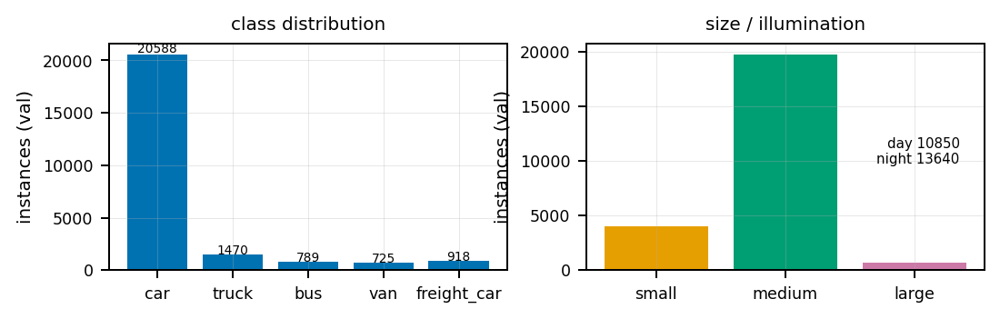
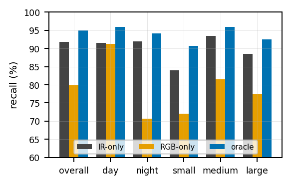
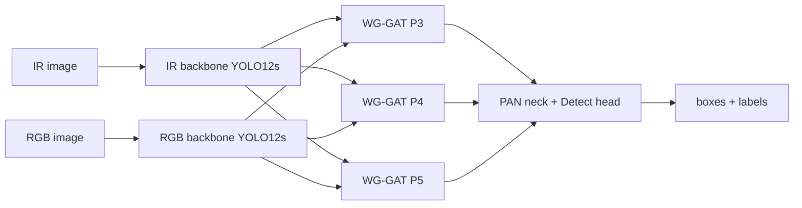
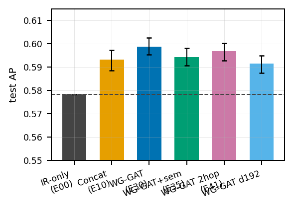
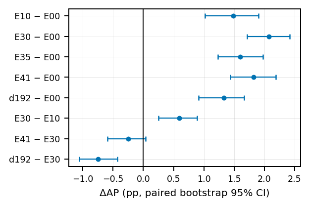
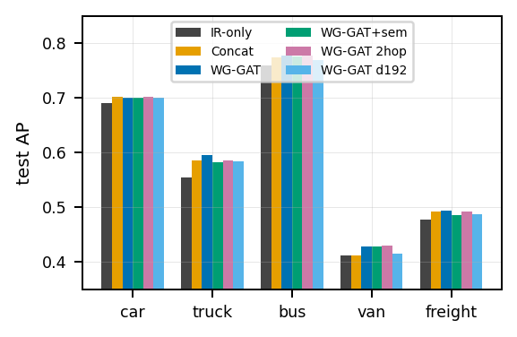
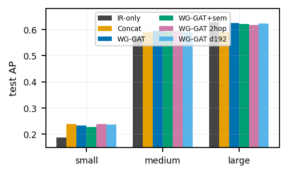
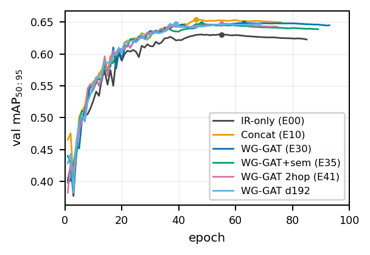

# WG-Fusion — Report v0 (team share)

**Status:** complete narrative + full experiment catalogue from current
artifacts. **Single seed** (seed 0) for all reported numbers; a seed-1 replica
of the main arm was partially run (best 0.64875 val @ep45) and is resumable.
Qualitative figures (attention maps, detection examples, confusion matrices)
are intentionally absent here — they belong to the next revision.

Every number is generated from the experiment artifacts (training curves,
locked-test metric JSONs, bootstrap JSONs, locks). Figures: `paper/figures/`;
regenerate with `python paper/make_figures.py`. Paper draft: `paper/main.tex`
(CVPR style).

---

## Abstract

Infrared (IR) and visible (RGB) cameras are increasingly co-mounted on aerial
platforms, so **paired IR–RGB detection** — not single-modality detection — is
the realistic deployment setting. We ask whether a *structured* cross-modal
graph interaction beats both the IR-only detector and simple learned fusion
when the training budget is held fixed. We introduce **WG-Fusion**, a
dual-stream detector in which each backbone level (P3/P4/P5) is fused by a
single window-graph attention layer: every IR feature-map cell is a node that
aggregates messages from its eight IR grid neighbours and from a 3×3
cross-modal window of RGB cells, with edge features (offset, cosine similarity,
node quality) and an IR-anchored gated residual. On DroneVehicle, at the
reference recipe and budget, WG-Fusion raises the locked 8,980-image test AP
from **0.5783 (IR-only) to 0.5988** (+2.08 pp, paired-bootstrap 95 % CI
[+1.71, +2.42]) and **significantly beats concat fusion** (+0.59 pp, CI
[+0.25, +0.89]). On the 1,469-image split used by prior work it reaches
**85.8 / 64.8** mAP50 / mAP50-95, competitive with 2024–2026 attention, Mamba
and hypergraph methods. Ablations show that two stacked graph hops, a wider
graph (d=192) and semantic-kNN edges do **not** improve the mean, and that a
warm-started fine-tune degrades it: under a matched recipe the *formulation*
(mid-level, IR-anchored, local cross-modal exchange) carries the gain, not
graph hyper-parameters.

---

## 1. Introduction

Aerial object detection must work across the full diurnal cycle. A visible
camera provides texture and fine boundaries but fails at night, in glare, fog
or motion blur; a thermal camera sees vehicles through darkness but lacks
texture and merges adjacent objects. The sensors are complementary, and modern
drone payloads carry both — usually already geo-aligned. Hence **paired IR–RGB
detection** is the natural formulation.

Fusion has been studied at three levels:

| Level | Idea | Weakness |
|---|---|---|
| Early (input) | 6-channel input | cannot model modality-specific statistics |
| Late (box) | fuse detections, e.g. WBF | cannot improve features |
| **Mid-level (features)** | exchange features at P3/P4/P5 | the design space we study |

Recent mid-level methods add structure: cross-attention (ICAFusion,
PNAFusion), state-space interaction (AMSRDet, COMO, MambaRefine), or graph /
hypergraph reasoning (HyperDet). Two questions remain under-addressed:

1. **At a fixed budget, is a structured module necessary?** Many comparisons
   use different backbones, resolutions or schedules, so architecture and
   recipe are confounded.
2. **Which part of a graph formulation matters?** Nodes, edges, edge features
   and depth are usually varied one at a time, on the same split used for
   selection.

We answer both on DroneVehicle with one detector, one recipe, one seed, and two
evaluation axes: the 1,469-image split on which prior work reports, and a
**pre-registered locked 8,980-image test set** never used for selection.

**Contributions**

1. **WG-Fusion** — a window-graph attention fusion layer at P3/P4/P5 of a
   dual-stream YOLO12s: IR nodes, 8 grid edges + 3×3 cross-modal window,
   5 edge features, masked softmax, IR-anchored gated residual; near-identity
   at initialisation.
2. **A controlled evaluation at matched budget**: +1.5…+2.1 pp over IR-only on
   the locked test across five fused variants; the window graph is
   **significantly** better than concat (+0.59 pp, CI excludes zero).
3. **A negative-result ablation suite**: depth, width, semantic edges and
   warm-start fine-tuning are neutral or harmful.
4. **A headroom analysis**: fusion captures most of the overall labelled-oracle
   gain; the largest remaining headroom is on small objects (+6.7 pp recall).

---

## 2. Problem statement, data and protocol

### 2.1 Task

Given an aligned pair (I_ir, I_rgb), predict boxes and labels for five classes
(car, truck, bus, van, freight car). Metrics: COCO AP (mAP50-95), AP50, and
APs/APm/APl, computed with pycocotools.

### 2.2 Dataset — DroneVehicle (and why)

DroneVehicle is the **largest paired aerial IR–RGB detection benchmark** with a
standard split: 17,990 train / 1,469 validation / 8,980 test pairs (we use
17,962 train after removing 28 frames with missing annotations). It has dense
small vehicles, five classes, and both day and night coverage — exactly the
conditions where fusion should matter. Multi-dataset validation (FLIR, VEDAI,
M3FD) is future work.



*Validation split: 24,490 instances (car 20,588; truck 1,470; bus 789; van 725;
freight 918); 10,850 day / 13,640 night; 3,996 small, 19,788 medium, 706 large
(COCO area thresholds).*

Supervision: thermal labels for the IR stream, visible labels for the RGB
stream; evaluation against thermal ground truth.

### 2.3 The two evaluation axes — why our val numbers are comparable to papers

Most published DroneVehicle numbers are reported on **the 1,469-image split
that we call validation**. Evidence from the papers themselves:

- **HyperDet (JKSU-CIS, Feb 2026)** writes: *"The dataset is split into 17,790
  image pairs for training. For testing, we use 1,469 image pairs."* — their
  "testing" split *is* our val set.
- **IV-PAFNet (PLOS ONE, Oct 2026)** follows the official split and, per its
  protocol, selects and reports on the 1,469 validation split.
- **CMEE-Det (Sci Rep 2026)** is the exception: it reports the 8,980 test split
  and obtains a much lower 77.6 mAP50 — consistent with a harder split.

"Val" means the split used for **checkpoint/hyper-parameter selection**. Papers
that report it are reporting a selected-on split, which is optimistic by ~2–5
pp relative to an untouched set. Our own gap: IR-only 63.06 val → 57.83 test
(−5.2 pp); WG-Fusion 64.84 → 59.88 (−5.0 pp).

**Our protocol is stricter, not different in kind:** we also select on val, but
then evaluate **once** on the untouched test split with a pre-registered lock
(checkpoint SHA-256 + recipe SHA-256 + metric recorded in
`results/LOCK_*.json` before any test prediction exists). Consequently:

- **Val numbers** → comparable to the literature (label: "1,469 split, as
  reported by prior work").
- **Locked test numbers** → our rigorous claim (label: different, harder
  split).
- Never mix the two axes in one comparison.

### 2.4 Oracle headroom

Per-annotation oracle: an annotation counts as detected if the IR-only **or**
RGB-only recall set contains it. Full table (validation):

| Stratum | IR recall | RGB recall | oracle | gain |
|---|---:|---:|---:|---:|
| overall | 91.79 | 79.81 | 94.97 | **+3.18 pp** |
| day | 91.59 | 91.25 | 95.93 | +4.34 pp |
| night | 91.95 | 70.70 | 94.20 | +2.25 pp |
| small | 84.03 | 72.00 | 90.77 | **+6.73 pp** |
| medium | 93.47 | 81.47 | 95.90 | +2.43 pp |
| large | 88.53 | 77.34 | 92.49 | +3.97 pp |

Annotation counts by oracle partition (val): both 18,767; IR-only 3,712;
RGB-only 778; neither 1,233.



---

## 3. Method — WG-Fusion

### 3.1 Overview

Dual-stream YOLO12s. IR stem initialised from COCO weights with per-filter
channel-mean grayscale adaptation; RGB keeps the original filters. At each
backbone output level (P3 80×64, P4 40×32, P5 20×16 for 640×512 inputs) a
window-graph attention layer fuses the two feature maps and returns a map of
the same shape, which replaces that level's anchor in the stock PAN neck and
detect head. **Boxes and labels come from the unmodified detector**; fusion
only rewrites the three anchor maps.



*(Full TikZ version with the graph inset: `paper/main.tex`, Fig. 1.)*

### 3.2 Graph construction

**Nodes.** The N = H·W cells of the IR feature map. Each node has a
d-dimensional projection of its IR feature; RGB cells are twin nodes (global
ids N…2N−1) with a separate projection. Only IR nodes are updated.

**Edges.** Every IR node receives messages from K = 8 + (2r+1)² = 17
neighbours at r = 1: its eight IR grid neighbours, and the nine RGB nodes in
the 3×3 window at the same location. Tables are fixed, precomputed per (H,W)
and cached; borders are masked and softmax runs over valid neighbours only.

**Edge features (E = 5):**

```
e_ij = [ Δx/ρ, Δy/ρ, cos(W h_i, W h_j), q_i, q_j ],   ρ = max(r,1)
q_*  = sigmoid(Conv1×1(f_*)) ∈ (0,1)   (shared head)
```

i.e. relative position, content similarity, and per-node reliability.

### 3.3 Window-graph attention

```
ℓ_ij = LeakyReLU( aᵀ [ W h_i ‖ W h_j ‖ W_e e_ij ] )
α_ij = softmax_{j∈N(i)} ( ℓ_ij )                    # masked
agg_i = Σ_j α_ij W_v h_j
g_i   = σ( MLP([ h_i ‖ agg_i ]) )                    # final bias −4.0
h'_i  = h_i + g_i ⊙ agg_i
Δ     = out(h')          →  [B, C, H, W]            # small init
f_fused = f_ir + Δ                                   # IR-anchored residual
```

Because the gate bias is −4.0 and the output projection is small-initialised,
the module is a **near-identity correction** on the IR stream at step 0: a
fused model never starts worse than its IR reference. Attention is computed in
fp32 under AMP; non-finite values raise instead of propagating.

**Parameters per level:** `P = 3Cd + 5d² + 6d + E² + 2E + 2C + 1` (0.64 M for
the three levels at d = 128).

### 3.4 Training recipe

End-to-end with the stock YOLO detection loss (CIoU box, BCE class, DFL)
through head, neck, both backbones and all fusion layers. Reference recipe
(matches the IR-only baseline exactly): MuSGD, lr0 0.01, final LR fraction
0.01 over 100 epochs, momentum 0.937, weight decay 5e-4, warm-up 3 epochs
(bias LR 0.1), batch 16 with gradient accumulation to nominal batch 64
(`nbs=64`), mosaic closing at epoch 90, patience 30, seed 0, 640 px,
deterministic, AMP + EMA. **No test data at any point.**

---

### 3.5 The full fusion-module catalogue (every rung in the study)

All modules share the same contract — `[B,C,H,W]` in, `[B,C,H,W]` out, applied
at P3/P4/P5 — so the detector, loss, schedule and evaluation are identical
across arms. The module is the only variable.

| Rung | Module | What it does exactly | Params / level | Used at |
|---|---|---|---|---|
| E02 | early fusion | 6-channel input (IR‖RGB) into a single YOLO12s; no dual stream | baseline model | reference |
| E03 | late fusion | WBF of E00 and E01 detections (IoU 0.6, weights 1.5/1.0, member scaling; 12-config grid selected on val) | training-free | reference |
| **E10** | concat + 1×1 | `f_fused = Conv1x1([f_ir ‖ f_rgb])`; no gate, no residual | `2C² + C` | screen, **full budget** |
| E14 | gated residual | `Δ = σ(W_g[z]) ⊙ W_o[z]`, `z=[f_ir‖f_rgb]`; gate bias −4, output init std 1e-7; `f_ir + Δ` | `4C² + 2C` | screen only |
| E21 | bidirectional cross-attention | project to d=128; shared q/k/v; each modality attends to the other over H·W tokens (single head, chunked, fp32); residual in d; project back to C; then E14 gate | `4Cd + 3d² + 4C² + 5d + 4C` | screen only |
| **E30** | window-graph GAT | §3.2–3.3: IR nodes, 8 grid + 3×3 cross-modal edges, 5 edge features, masked softmax, gated residual | `3Cd + 5d² + 6d + E² + 2E + 2C + 1` | screen, **full budget (main method)** |
| E35 | graph + semantic edges | E30 plus, per IR node, the top-k RGB nodes by cosine similarity inside Chebyshev radius R (k=6, R=4, center included); edges rebuilt every forward; **identical parameters to E30** | same as E30 | screen, full budget |
| **E41** | two-hop graph | hop1 = E30(f_ir, f_rgb); hop2 = E30(hop1, f_rgb); `f_fused = f_ir + (Δ1 + Δ2)`; hop 1 is bit-identical to E30 | **2× E30** | screen, full budget |
| control | dual-stream, fuse inert | E30 module with the fuse held at α = 0 for every epoch (`--fuse-warmup 10` on a 10-epoch run), so `f_fused = f_ir` bit-exactly; isolates the dual-stream architecture from fusion | same as E30 | screen |
| E22 | capacity control | parameter-matched but information-free fuse; **not run yet** | — | planned |

**Total model size** (backbones + fuse + neck/head): E10 15.49 M, E14 16.28 M,
E21 16.95 M, E30 15.35 M (d=128), E35 15.35 M, E41 ≈ 15.99 M,
d=192 ≈ 16.0 M. (The totals for E10/E14/E21/E30 come from the screening tier's
model summary; E41/d=192 are base + fuse delta.)

**Warm-up.** The `fuse_warmup`/`fuse_ramp` mechanism is not a module: it holds
α = 0 (fused ≡ IR stream) for K epochs and then ramps α to 1 over R epochs.
It is used by the control, by the warm-start runs (fidelity gate), and is the
B1 capability in the backlog.

**What E10 is, precisely** (the "normal learned fusion" reference): a single
1×1 convolution over the concatenation of the two feature maps, with bias and
no nonlinearity. It can learn an arbitrary per-channel linear mixing of the
modalities but has no notion of spatial neighbourhood or cross-modal
correspondence. It is the fairest "simple learned mid-level fusion" bar.

**What E41 is, precisely** (the depth ablation): the E30 layer applied twice
with independent parameters. Because each hop is the already-validated E30
code, hop 1 is exactly E30 and the only change is a second relational pass
over the same 17-edge neighbourhood — a 2-hop receptive field along the grid +
window graph. Parameters are exactly doubled (1.29 M vs 0.64 M over the three
levels), and it costs twice the edge-tensor memory (28.2 GB at batch 16).

**What E14 and E21 are, and their status**: E14 (gated residual) and E21
(cross-attention) were evaluated only at the 10-epoch screen level. Their full
budget is the main missing comparison of the study, and is stated as a
limitation (§12); the paper therefore does not rank them against E30.

---

## 4. Experimental setup

One detector, one dataset, one recipe, one seed; the only difference between
arms is the fusion module (or its absence). Training on a single 48 GB GPU;
fusion in fp32 under AMP. AP via pycocotools; CIs from paired image-level
bootstrap (500 resamples; the same resampled images are used for every model,
which cancels image-level difficulty). Evaluator self-check: the bootstrap's
101-point AP re-implementation reproduces pycocotools to 0–1e-16 before any
delta is computed.

---

## 5. Results

### 5.1 Locked test set (8,980 images) — the claim

| Arm | AP | AP50 | APs | APm | APl | ΔAP vs IR (95 % CI) |
|---|---:|---:|---:|---:|---:|---|
| IR-only (E00) | 0.5783 | 0.7628 | 0.1866 | 0.5750 | 0.6298 | — |
| Concat + 1×1 (E10) | 0.5931 | 0.7754 | 0.2381 | 0.5912 | 0.5904 | +1.49 pp [+1.02, +1.90] |
| **WG-Fusion (E30)** | **0.5988** | **0.7819** | 0.2336 | **0.5951** | 0.6245 | **+2.08 pp [+1.71, +2.42]** |
| WG-Fusion, 2 hops (E41) | 0.5969 | 0.7784 | **0.2388** | 0.5939 | 0.6181 | +1.83 pp [+1.44, +2.19] |
| WG-Fusion, semantic edges (E35) | 0.5943 | 0.7770 | 0.2273 | 0.5921 | 0.6217 | +1.60 pp [+1.23, +1.97] |
| WG-Fusion, d=192 | 0.5914 | 0.7760 | 0.2364 | 0.5881 | 0.6231 | +1.33 pp [+0.91, +1.67] |



**Key contrasts (paired bootstrap):**

| Contrast | ΔAP | 95 % CI | P(Δ>0) |
|---|---:|---|---:|
| WG-Fusion − IR-only | +2.075 pp | [+1.712, +2.421] | 1.000 |
| **WG-Fusion − concat** | **+0.591 pp** | **[+0.247, +0.892]** | **1.000** |
| 2 hops − WG-Fusion | −0.250 pp | [−0.594, +0.036] | 0.046 |
| d=192 − WG-Fusion | −0.745 pp | [−1.054, −0.428] | 0.000 |
| semantic edges − concat | +0.100 pp | [−0.261, +0.473] | 0.717 |



**Per-class test AP:**

| Arm | car | truck | bus | van | freight |
|---|---:|---:|---:|---:|---:|
| IR-only | 0.6904 | 0.5542 | 0.7587 | 0.4114 | 0.4767 |
| concat | **0.7023** | 0.5854 | **0.7739** | 0.4116 | 0.4923 |
| **WG-Fusion** | 0.7007 | **0.5953** | 0.7765 | **0.4279** | **0.4937** |
| 2 hops | 0.7013 | 0.5851 | 0.7772 | 0.4294 | 0.4913 |
| semantic | 0.7006 | 0.5827 | 0.7758 | 0.4274 | 0.4850 |
| d=192 | 0.7006 | 0.5843 | 0.7697 | 0.4156 | 0.4871 |



**Scale trade-off.** Concat buys the largest small-object gain (APs 0.2381 vs
IR 0.1866) but *loses* large-object AP (0.5904 vs 0.6298); the graph arms gain
nearly as much on small objects while preserving large-object performance
(WG-Fusion 0.6245). WG-Fusion improves every scale band (APs +4.71,
APm +2.01, APl ≈ flat).



### 5.2 Validation-axis curves



Best validation values: IR 0.6306 (ep55), concat 0.6538 (ep46), WG-Fusion
0.6484 (ep63), 2-hop 0.6471 (ep55), semantic 0.6471 (ep48), d=192 0.6476
(ep39). **Val/test ranking inversion:** concat leads on val, WG-Fusion leads on
test (with the paired CI above). Single-seed differences of ~0.5 pp are not
settled rankings — a key argument for the locked-test axis.

---

## 6. Full experiment catalogue

This section lists **every run** in the experiment directory, with the config
and the score. Runs marked *quarantined* are pipeline-defect evidence and must
not be quoted as fusion results. Every run's resolved config is stored with it
(`runs/<name>/args.yaml`, `runs/<name>/ref_meta.json`,
`runs_g2/<name>/ref_meta.json`).

### 6.0 How each tier was configured

| Tier | Data | Schedule | Notes |
|---|---|---|---|
| Reference (E00–E03) | full train | 100 ep, MuSGD lr0 0.01, lrf 0.01, batch 16, close_mosaic 10, patience 30, seed 0 | locked test |
| V1 screen (quarantined) | ⅓ train (6,000 frames, 15 blocks) | 100 ep, auto-resolved AdamW lr 1.11e-3 | loader-defect tier |
| V2 screen | full train | **10 ep prefix** of E00's LR schedule (`lrf` 0.92856 so LR at epoch k equals E00's), mosaic kept on (close_mosaic 0), batch 16, seed 0 | plumbing screen |
| Flagships | full train | 100 ep, E00 recipe (as reference) | E10/E30/E35 |
| Warm-start family | full train | fine-tune: lr0 0.002, lrf 0.1, patience 20, close_mosaic 5, fuse warm-up 2 / ramp 2, streams initialised from E00 (IR + neck/head) and E01 (RGB) | technique ablation |
| E41 (2 hops) | full train | 80 ep, E00 recipe, batch 16, patience 20 | depth ablation |
| d=192 | full train | 100 ep, E00 recipe, batch 16, patience 30 | capacity ablation |
| Seed replicate | full train | identical to E30, seed 1 | stopped (resumable) |

### 6.1 Reference tier (audited, locked test)

| Run | Config | val mAP50-95 (best ep) | val mAP50 | test AP | AP50 | APs | APm | APl |
|---|---|---:|---:|---:|---:|---:|---:|---:|
| `e00_ir` | IR-only YOLO12s, 100 ep | 0.6306 (55) | 0.8423 | **0.5783** | 0.7628 | 0.1866 | 0.5750 | 0.6298 |
| `e01_rgb` | RGB-only YOLO12s, 100 ep | 0.5882 (84) | 0.8132 | 0.4126 | 0.6534 | 0.1348 | 0.4132 | 0.4338 |
| `e02_fused` | early fusion, 6-ch input, 100 ep | 0.5047 (100) | 0.7338 | 0.4762 | 0.6942 | 0.0947 | 0.4705 | 0.5587 |
| `e03_late_fusion` | training-free WBF of E00+E01 | — | — | 0.5794 | 0.7868 | 0.2087 | 0.5760 | 0.6313 |

### 6.2 V1 pipeline-defect evidence (QUARANTINED — not fusion results)

| Run | val mAP50-95 | note |
|---|---:|---|
| `e00_ir_unified` | 0.1829 | IR-only, V1 loader — collapsed too |
| `e30_unified` | 0.1429 | E30, V1 loader |
| `e10_screening` | 0.2403 | V1 screening tier |
| `e14_screening` | 0.2438 | V1 |
| `e21_screening` | 0.2258 | V1 |
| `e30_screening` | 0.2521 | V1 |
| `e35_screening` | 0.2329 | V1 |
| `e00_ir_v1loader_10ep_PARTIAL` | 0.0236 | 10-ep V1-loader ablation |
| `e00_ir_v2_10ep` | **0.5377** | same 10-ep budget, V2 loader — the fix |

The defect was isolated to the data loader: V2 reproduces the stock
Ultralytics IR path bit-identically. Quarantined runs are retained only as
evidence.

### 6.3 V2 screens (10 epochs, prefix-of-E00 schedule)

| Run | Module | best val (ep) | val mAP50 |
|---|---|---:|---:|
| `e10_v2_10ep` | concat + 1×1 | **0.56665 (10)** | 0.7764 |
| `e14_v2_10ep` | IR-anchored gated residual | 0.55125 (9) | 0.7679 |
| `e21_v2_10ep` | bidirectional cross-attention | 0.54744 (10) | 0.7499 |
| `e30_v2_10ep` | window-graph GAT | 0.54067 (8) | 0.7544 |
| `e00_fusedctl_v2_10ep` | inert-fuse control | 0.53625 (10) | 0.7425 |
| `smoke_pair_v2_1ep` | 1-ep plumbing smoke | 0.30413 (1) | 0.4713 |

Screens are a plumbing/gross-failure filter; the 1.4–3.7 pp spread does not
support a ranking. The control row is the E30 architecture with the fuse held
at α = 0 (inert) for every epoch — it isolates the dual-stream architecture
from fusion. E14 and E21 were **not** carried to full budget; that is the main
missing comparison of the study (see §12).

### 6.4 Flagships (100 epochs, matched recipe)

| Run | Epochs run (stop) | best ep | val mAP50-95 | val mAP50 | test AP |
|---|---:|---:|---:|---:|---:|
| `e10_v2_100ep` | 76 (early, patience 30) | 46 | **0.65380** | 0.86470 | 0.59309 |
| `e30_v2_100ep` | 93 (early) | 63 | 0.64838 | 0.85802 | **0.59881** |
| `e35_v2_100ep` | 89 (early) | 48 | 0.64714 | 0.85598 | 0.59429 |

### 6.5 Extended series (`runs_g2`, 2026-11-25 → 27)

**Warm-start family** (IR stream + neck/head from `e00_ir`, RGB backbone from
`e01_rgb`, fuse modules fresh; fuse held at α=0 for 2 epochs then ramped over
2; fine-tune lr0 0.002, lrf 0.1):

| Run | Config | result | verdict |
|---|---|---|---|
| `e30ws_smoke_3ep` | 3 ep, fuse frozen ep1–2 | ep1 **0.61713** (E00-level) | fidelity proven |
| `e30ws_screen_10ep` | 10 ep | best ep1 0.62071, degrades to ~0.61 | fails |
| `e30ws_v2_50ep` | 50 ep fine-tune | **0.62168 @ep21** (41 ep, early stop) | fails (far below 0.648) |
| `e30r2ws_screen_10ep` | r=2, 10 ep | CUDA OOM at batch 16 (ep1 only, 0.62071) | memory-infeasible |

Interpretation: a converged-from-E00 initialisation plus mosaic + low LR leaves
the fusion no room to improve; the model hovers at its starting point.

**E41 — two stacked WG-GAT hops** (depth):

| Run | Config | result |
|---|---|---|
| `e41_screen_10ep` | 10 ep, batch 8 (effective 64) | **0.54559 @ep9** (E30 0.54067) → promoted |
| `e41_v2_80ep` | 80 ep, batch 16 | **75 ep (early)**, best **0.64705 @ep55**, val mAP50 0.85841 |
| locked test | one-shot | **AP 0.59685**, AP50 0.77844, **APs 0.23876 (best)**, APm 0.59392, APl 0.61814 |
| vs E00 | bootstrap | **+1.825 pp** [+1.440, +2.187] |
| vs E30 | bootstrap | −0.250 pp [−0.594, +0.036] (n.s.) |

**E30 d=192** (capacity):

| Run | Config | result |
|---|---|---|
| `e30d192_screen_10ep` | 10 ep, d=192 | **0.54407 @ep10** (E30 0.54067) → promoted |
| `e30d192_v2_100ep` | 100 ep, d=192 | **69 ep (early)**, best **0.64755 @ep39**, val mAP50 **0.86189** (highest) |
| locked test | one-shot | **AP 0.59145**, AP50 0.77599, APs 0.23640, APm 0.58806, APl 0.62314 |
| vs E00 | bootstrap | **+1.330 pp** [+0.914, +1.668] |
| vs E30 | bootstrap | **−0.745 pp** [−1.054, −0.428], P = 0.000 |

**Seed replicate** (stopped, resumable):

| Run | Config | result |
|---|---|---|
`e30seed1_v2_100ep` | E30 config, seed 1 | **54 ep stored, best 0.64875 @ep45** (seed 0: 0.64838); resumable from `last.pt` (epoch 53 stored → resumes at display 55; EMA + optimizer + scaler + train_args intact) |

### 6.6 Incomplete/aborted attempts (kept for the record)

| Run | State | Reason |
|---|---|---|
| `e10_screening_PARTIAL_2ep` | 2 ep | V1-era batch attempt |
| `e35_screening_INVALID_batch8oom` | 2 ep | OOM |
| `e35_screening_INVALID_ep3_val_nan` | 2 ep | non-finite validation |
| `e02_fused_PARTIAL_w8` | 2 ep | V1-era attempt |
| `e30_full_PARTIAL_ep3` | 3 ep | V1-era attempt |
| `e00_ir_noaug_screening` | 32 ep, no DONE | augmentation ablation, superseded |

---

## 7. Comparison with published DroneVehicle results

**Caveat:** values are not comparable across papers without care — split
(val vs test), box protocol (oriented vs horizontal), GT-stream policy, and
reproduction variance (the same method can appear 2–9 pp apart). Only
same-table comparisons are meaningful.

### 7.1 Anchor table — HyperDet (JKSU-CIS, Feb 2026), 1,469 split

HyperDet re-compares 18 methods under one protocol on the **same 1,469-image
split we use for val**, reporting mAP50 and mAP50-95. Values as reported there:

| Method (venue/date) | mAP50 | mAP50-95 |
|---|---:|---:|
| CFT (arXiv'21/TGRS'22) | 84.3 | 61.9 |
| SuperYOLO (TGRS'23) | 81.4 | 58.6 |
| ICAFusion (PR'24, re-run) | 75.4 | 52.6 |
| MGMF (TGRS'24) | 80.3 | 55.2 |
| GM-DETR (2024) | 80.8 | 55.9 |
| M2D-LIF (arXiv'25) | 84.5 | — |
| RGFNet (TGRS'25) | 83.8 | — |
| C2DFF-Net (TGRS'25) | 85.7 | 65.2 |
| COMO (Information Fusion'26) | 85.3 | 63.4 |
| **HyperDet-N (JKSU-CIS, Feb'26, hypergraph, 3.2 M)** | **86.4** | **65.9** |
| **HyperDet-S (Feb'26)** | **87.5** | **67.1** |
| *IR-only (ours)* | *84.23* | *63.06* |
| **WG-Fusion (ours)** | **85.80** | **64.84** |

**Reading.** WG-Fusion is above every 2023–2025 entry on both metrics,
including C2DFF-Net (85.7/65.2), and 0.5–1.7 pp behind the Feb-2026 hypergraph
frontier. The IR-only baseline alone (84.2/63.1) already matches or beats most
published *fused* methods through 2024 — detector base and protocol dominate
cross-paper deltas, which is why the controlled Δ over IR-only is the
meaningful number.

### 7.2 Other methods in circulation (their own protocols)

| Method (venue/date) | DroneVehicle value | protocol note |
|---|---|---|
| UA-CMDet (DroneVehicle paper, IEEE TCSVT'22) | mAP50 64.01 | oriented boxes, RoITransformer baseline |
| IV-PAFNet (PLOS ONE, Oct 28 2026) | **62.81 ± 0.70** AP50-95 / **85.64** AP50 | 640×640 squash, visible GT both streams, val, 3 seeds, RT-DETR |
| ICAFusion (PR'24, own README) | mAP50 84.8 | undocumented protocol; other sources 78.6 / 75.4 — treat with caution |
| PNAFusion (arXiv'26) | mAP50 85.5 | YOLOv5; per-class 98.1/85.0/97.2/71.7/75.8 |
| SuppreSensing (ACM MM'26) | mAP50 81.2 | |
| MambaRefine-YOLO (arXiv'26) | mAP@0.5 83.2 | YOLO11-based, 300 ep |
| AMSRDet (Sensors, Jan'26) | 81.2 AP50 / 45.8 AP50-95 | RT-DETR + Mamba |
| CMEE-Det (Sci Rep'26) | mAP50 77.63 (test) | YOLOv5-based; test split |
| DEPF (arXiv'25) | ~78.9 AP50 / ~51.2 AP50-95 | **oriented-box protocol** — not comparable |
| DOD-SA (arXiv'25) | IR-test 77.29 AP50 | single-modality-annotation, OBB — not comparable |
| C2DFF-Net (IEEE TGRS'25) | 85.7 / 65.2 | via HyperDet's table (paywalled) |
| HyperDet (JKSU-CIS'26) | 86.4/65.9 (N), 87.5/67.1 (S) | hypergraph, 1,469 split |

**Against IV-PAFNet:** our fused val is +1.6 to +2.6 pp on AP50-95 and +0.4 to
+0.9 on AP50 — but our IR-only baseline alone edges its fused number, so the
margin is detector base + protocol, not fusion. **Against ICAFusion:** E10
+1.7 pp, E30/E41 +1.0 pp on mAP50; IR-only is already 84.2. **Against the
frontier:** 0.5–1.7 pp behind HyperDet on the same split.

---

## 8. Ablations (each varies one factor, matched recipe)

| Variant | val mAP50-95 | test AP | Δ test vs WG |
|---|---:|---:|---|
| **WG-Fusion (1 hop, d=128)** | 0.6484 | **0.5988** | — |
| 2 hops (E41) | 0.6471 | 0.5969 | −0.25 (n.s.) |
| d=192 | 0.6476 | 0.5914 | −0.75 (sig. worse) |
| semantic-kNN edges (E35) | 0.6471 | 0.5943 | −0.45 |
| warm-start fine-tune | 0.6217 | — | — |
| r=2 window | OOM at batch 16 | — | — |
| IR-only | 0.6306 | 0.5783 | −2.08 |
| concat | 0.6538 | 0.5931 | −0.59 (sig.) |

Reading: **depth** helps small objects (best APs) but not the mean; **width**
significantly hurts on test despite an equal val score (a val-selection
warning); **edge content** is neutral; **warm-start fine-tuning** fails; **r=2**
is memory-infeasible at the matched batch.

---

## 9. Inference-time ensembles (post-hoc, no training)

| Ensemble (WBF, fixed defaults: IoU 0.55, one box per source) | AP | AP50 | APs | APm | APl |
|---|---:|---:|---:|---:|---:|
| concat + WG-Fusion + semantic | **0.6211** | 0.8072 | 0.2488 | 0.6178 | 0.6564 |
| WG-Fusion + semantic | 0.6128 | 0.7983 | 0.2399 | 0.6094 | 0.6512 |

Reported separately from the trained models. The arms are complementary:
concat contributes car/bus strength, graphs contribute truck/van/freight and
preserve large objects.

---

## 10. Efficiency

| Arm | fusion params | total params | epoch time | peak GPU mem |
|---|---:|---:|---:|---:|
| WG-Fusion (d=128) | 0.64 M | 15.3 M | ~4.9 min | 21.6 GB |
| 2 hops (E41) | 1.29 M | ~15.9 M | ~6.2 min | 28.2 GB |
| d=192 | ~1.3 M | ~16.0 M | ~6.0 min | 26.5 GB |
| semantic edges (E35) | 0.64 M | 15.3 M | ~14.3 min | 35.3 GB |

The semantic-kNN variant is the most expensive because content-dependent edges
are rebuilt every forward; the two-hop variant doubles the edge-tensor memory.

---

## 11. Seeds

All reported numbers are **single-seed** (seed 0). Seed 1 of WG-Fusion was
started and stopped for compute priority after 54 epochs: **best 0.64875 @ep45**
(vs 0.64838 for seed 0) — an encouraging but anecdotal agreement. The run is
fully resumable (`last.pt`: epoch 53 → display 55; EMA/optimizer/scaler/
train_args intact). Multi-seed reporting is the main remaining robustness item.

---

## 12. Discussion and limitations

**What the results say.** Under a matched recipe, mid-level fusion reliably
improves paired IR–RGB detection (+1.5…+2.1 pp locked test), and the window
graph is significantly better than plain concat. The graph's structure has a
**flat optimum**: depth, width and edge content do not move the mean. The
*inductive bias* — local cross-modal exchange applied as an IR-anchored
residual — is what matters.

**Limitations.** (i) Single seed for all arms (seed-1 partial only).
(ii) Validation is used for selection, as in prior work; the locked test is the
rigorous axis. (iii) The graph is local and single-scale; cross-scale edges
(P4/P5 → P3) are the natural next step for the small-object headroom.
(iv) Only DroneVehicle is covered; multi-dataset validation pending.
(v) The 2-hop small-object advantage is not significant overall.
(vi) The SOTA comparison is contextual, not controlled — no external method was
retrained under our protocol (no accessible weights for ICAFusion; IV-PAFNet
code is available and is the natural Tier-A candidate).
(vii) **E14 (gated residual) and E21 (cross-attention) were only screened at 10
epochs**; the study therefore cannot claim a full-budget comparison against a
non-graph attention baseline. E21 is the most important missing run for the
paper's story.

---

## 13. Next steps

1. Multi-seed reporting for WG-Fusion (resume seed 1; add seed 2).
2. Qualitative figures: attention-mass maps (grid vs cross-modal edges),
   per-level |Δ| maps, day/night detection examples, confusion matrices.
3. Implement and screen cross-scale edges (`E50`) for the small-object
   headroom (+6.7 pp oracle recall).
4. TTA inference variant (export script already supports `--tta`).
5. Multi-dataset validation (FLIR-aligned, VEDAI).
6. Tier-A: retrain IV-PAFNet (open code) under our protocol, scored by our
   evaluator.

---

## Appendix A — reproduction

- Figures: `python paper/make_figures.py`
- LaTeX paper: `paper/main.tex` (CVPR review style; compile on Overleaf)
- Flagship drivers: `scripts/run_v2_{e30,e10,e35}_100ep.sh`
- Generic driver: `scripts/run_v2_arm.sh` (uses `srun --ntasks=1`; see
  Appendix B)
- Run artifacts: `runs/` (flagships), `runs_g2/` (extended), `results/`
  (metrics, bootstrap, locks, GT/preds)

## Appendix B — operational notes (why some runs look unusual)

- **Allocation boundaries**: runs are cut at 24 h allocation limits and resume
  from `last.pt` (full state). E30, E10, E35 and E41 all crossed at least one
  boundary during this campaign.
- **Multi-task `srun` pitfall**: on a 32-CPU allocation, `srun` without
  `--ntasks=1` launches one training copy per task; four copies on the same run
  directory caused host-RAM OOM (64 GB cgroup), duplicated CSV rows and
  auto-batch collapse. All drivers now pass `--ntasks=1`.
- **CPU-only steps** (evaluation, bootstrap) must pass `--gres=none` and
  `--overlap`; otherwise they inherit the GPU gres and serialize behind
  training.
- **Locked test protocol**: `results/LOCK_<exp>.json` records checkpoint and
  recipe SHA-256, split, metric and timestamp; `scripts/final_eval.py` refuses
  to run without a lock. Locks were created before any test prediction existed.
